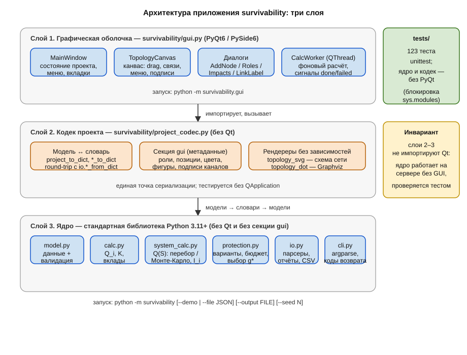

# Руководство программиста

Архитектура, модули, алгоритмы и приёмы разработки приложения
**survivability**. Предполагается чтение вместе с исходниками в каталоге
`survivability/`; имена классов и функций приведены для навигации.
Пользовательская сторона — в [user-guide.md](user-guide.md).

## 1. Архитектура: три слоя

Приложение разделено на три слоя с однонаправленными зависимостями
(сверху вниз):

1. **Графическая оболочка** — `survivability/gui.py` (PyQt6/PySide6).
   Единственный модуль, требующий Qt. Запуск: `uv run python -m survivability.gui`.
2. **Кодек проекта** — `survivability/project_codec.py`. Преобразование
   моделей в JSON-совместимые словари, сериализация служебной секции `gui`
   (роли, координаты, цвета, фигуры, подписи каналов), рендереры SVG/DOT.
   **Не зависит от Qt** — тестируется без QApplication и пригоден для
   других фронтендов.
3. **Ядро** — `model.py`, `calc.py`, `system_calc.py`, `protection.py`,
   `io.py`, `cli.py`, `__main__.py`. Только стандартная библиотека
   Python 3.11+; не знает ни о Qt, ни о JSON-секции `gui`.

Инвариант: **ядро и кодек не импортируют PyQt** (проверяется тестом
`TestCoreIndependentOfQt` с блокировкой импорта Qt через `sys.modules`).
Благодаря этому расчёт работает на сервере без графической среды, а тесты
ядра проходят без установленного PyQt.

## 2. Модули ядра

### `model.py` — модель данных и валидация

Датаклассы предметной области, все `frozen=True`:

- `Impact` — деструктивное воздействие $d_j$: `name`, `intensity`
  ($\lambda_j$), `defeat_probability` ($p_{ij}$); свойство `hazard`
  ($\lambda_j p_{ij}$).
- `NodeInput` — входные данные задачи 1: `name`, `own_failure_rate`
  ($\lambda_i^{(0)}$), `impacts`, `recovery_rate` ($\mu$), `period` ($T$);
  свойство `total_hazard` ($\Lambda_i$).
- `SystemInput` — структурная модель $S = \langle E, L, F \rangle$:
  `nodes`, `links` (неориентированные пары имён), `w_def`, `target`
  (см. `SYSTEM_TARGETS`), `monte_carlo_runs`, `seed`. Валидация: непустота,
  уникальность имён, $W_{\text{доп}} \in [0;1]$, известный `target`,
  целостность связей (без петель и дубликатов).
- `NodeOverride`, `ProtectionVariant`, `ProtectionInput` — задача 3:
  переопределения параметров узлов, добавляемые связи, стоимость $C(g)$,
  бюджет $C_{\text{доп}}$; `ProtectionVariant.validate_against(system)`
  проверяет ссылки на элементы базовой системы.

Единый класс ошибок `ValidationError(ValueError)`. Валидация — в
`__post_init__`, поэтому некорректный объект невозможно создать ни из CLI,
ни из GUI, ни из теста.

### `calc.py` — формулы задачи 1

- `survivability(node) -> float` — $Q_i(T)$: при $\mu = 0$ экспонента
  $e^{-\Lambda_i T}$, иначе решение марковской модели «отказ–восстановление»
  (вывод — в [formulas.pdf](formulas.pdf), раздел «Марковская модель»);
- `steady_state_availability(node) -> float` — предельный коэффициент
  готовности $K = \mu / (\Lambda_i + \mu)$;
- `impact_contributions(node) -> list[ImpactContribution]` — доли
  источников ущерба $s_j = \lambda_j p_{ij} / \Lambda_i$ (плюс собственные
  отказы).

### `system_calc.py` — задача 2

- `node_survivabilities(system)` — вектор $Q_i$ по `calc.py`;
- `build_adjacency`, `w_node_fraction(mask, adj, n)`,
  `w_connectivity(mask, adj, n)` — целевые функции $W(X)$ на битовой маске
  состояний; `SYSTEM_TARGET_NODE_FRACTION`, `SYSTEM_TARGET_CONNECTIVITY`;
- `qs_exact(system, q)` — точный перебор всех $2^n$ векторов при
  $n \leq$ `EXACT_MAX_NODES` (= 20);
- `qs_monte_carlo(system, q, runs, rng)` — оценка $\hat{Q}(S) = N^*/N$,
  доверительный интервал Уилсона `wilson_interval(successes, runs,
  z=WILSON_Z)`;
- `system_qs(system, q=None, rng=None)` — выбор способа по размеру системы;
  возвращает `SystemEstimate` (оценка, метод, ДИ, число прогонов);
- `node_importance(system, estimate)` — критичность Бирнбаума
  $I_i = Q(S \mid x_i = 1) - Q(S \mid x_i = 0)$: за один проход перебора
  (`importance_exact`) либо `importance_monte_carlo` (условные прогоны);
  возвращает `NodeImportance`.

### `protection.py` — задача 3

- `apply_variant(system, variant) -> SystemInput` — «накладка» варианта
  поверх базовой системы: переопределённые параметры и резервные связи
  порождают новый валидированный `SystemInput`;
- `compare_protection(system, protection, seed=None) -> ProtectionResult` —
  для каждого варианта оценка $Q_g(S)$ тем же способом, что и $Q(S)$;
  **общий генератор случайных чисел** для всех вариантов (снижает дисперсию
  сравнения — оценки зависимы от одних случайностей); допустимость по
  бюджету; $g^* = \arg\max$ (при равенстве — меньшая стоимость, затем имя);
  производные показатели $\Delta Q$, относительный прирост, эффективность
  затрат. Пустое допустимое множество — `ValidationError`.

### `io.py` — ввод/вывод

Парсеры-сборщики моделей из словарей (единая точка валидации):
`node_from_dict`, `system_from_dict`, `protection_from_dict`, агрегат
`job_from_json(path) -> InputJob` — распознаёт режим по ключам верхнего
уровня (`system`/`protection` → система, иначе одиночный узел).
Демонстрация и интерактив: `demo_node()`, `prompt_node()` (повторный запрос
при некорректном вводе). Форматирование и экспорт: `format_report`,
`format_system_report`, `format_protection_report`; `save_json`/`save_csv`
(узел), `save_system_json/csv`, `save_protection_json/csv`. Все функции
экспорта переиспользуются GUI («Экспорт результатов»).

### `cli.py` и `__main__.py` — командная строка

`build_parser()` — `argparse`: взаимоисключающие `--demo` и `--file`,
`--output` (формат по расширению: `.json` иначе CSV), `--seed` (перекрывает
поле файла). `main()` маршрутизирует `InputJob` по трём режимам и
определяет коды возврата: `0` — успех, `2` — ошибка ввода, `1` — ошибка
записи. `__main__.py` — тонкая обёртка `sys.exit(main())`.

## 3. Кодек проекта — `project_codec.py`

Слой между моделью и представлением, намеренно без Qt:

- **Модель → словарь**: `node_to_dict`, `system_to_dict`,
  `protection_to_dict`, `project_to_dict(system, protection=None)`.
  Совместное использование с парсерами `io.*_from_dict` даёт round-trip
  «словарь ↔ модель без потерь»;
- **Секция `gui`** (метаданные оболочки, CLI её не читает): константы
  `DEFAULT_ROLES` (встроенная библиотека ролей), `NODE_SHAPES`,
  `DEFAULT_NODE_COLOR`, `DOT_SHAPES`; валидация ролей через конструктор
  узла `validate_role`; очистка «best effort» `sanitize_gui_section`
  (неизвестные ключи и повреждённые записи отбрасываются); доступоры
  `node_style`, `set_node_style` (сентинел `_UNSET`: `None` — сброс),
  `positions_from_section`/`set_positions`,
  `link_labels_from_section`/`set_link_label`, мутации структуры
  `rename_node_in_gui`, `drop_node_from_gui`, `drop_link_from_gui`,
  `prune_gui_section`, `user_roles`, `builtin_roles` (глубокие копии);
- **Раскладка**: `circle_layout(names, width, height, margin)` —
  окружность по умолчанию;
- **Рендереры**: `topology_svg(system, node_values, color_by, positions,
  title, styles, link_labels)` — собственный SVG без зависимостей:
  фигуры узлов (`rect`/`ellipse`/`polygon`), ручные цвета (тепловая шкала
  при заданных значениях имеет приоритет), подписи каналов с белым
  контуром, легенда; `topology_dot(system, styles)` — Graphviz с
  маппингом фигур на `shape`.

## 4. Графическая оболочка — `gui.py`

Запуск `uv run python -m survivability.gui`, точка входа `main()` → `QApplication`
+ `MainWindow`. Импорты Qt — только внутри модуля (try PyQt6, fallback
PySide6). Состав:

- `default_project()` — шаблон нового проекта (словарь формата CLI);
- `CalcWorker(QThread)` — расчёт в фоновом потоке, сигналы `done_qs`
  (оценка + важность), `done_protection`, `failed`;
- `ImpactsDialog` — таблица воздействий (переиспользуется для узлов,
  переопределений вариантов и ролей);
- `AddNodeDialog` — имя + выбор роли (предзаполнение, имя-от-роли
  с уникальным номером);
- `RolesDialog` — редактор пользовательских ролей; `accept()` валидирует
  все роли через `validate_role`, при ошибке не закрывается;
- `TopologyCanvas(QAbstractScrollArea)` — канвас с масштабом (25–400 %)
  и прокруткой: `positions` хранят координаты схемы, экранная точка
  viewport'а `s = p · zoom − offset` (offset — значения полос прокрутки);
  преобразования `to_scene`/`to_screen`, отрисовка через
  `QPainter.translate/scale`, порог попадания по связи — в экранных
  пикселях; `set_zoom(zoom, anchor)`, `fit_to_view`, сигнал
  `zoom_changed`; `repaint()` пересчитывает область прокрутки (узлы ∪
  видимая область). Масштаб и прокрутка в проект не сохраняются.
  Перетаскивание узлов, выбор,
  режим добавления связи, удаление (Delete/кнопка/меню), двойной клик
  по связи → сигнал `link_double_clicked` (подпись), контекстное меню
  (цвет/фигура/подпись/удаление), отрисовка фигур `QPolygon`/`drawEllipse`/
  `drawRoundedRect`, подписей с `OpaqueMode`-фоном, тепловой шкалы;
  сигналы `structure_changed`, `style_changed`, `node_moved`,
  `node_clicked`;
- `MainWindow(QMainWindow)` — состояние: `project` (словарь формата CLI
  + секция `gui`), `positions` (живые координаты), `current_path`,
  `dirty`. Синхронизация: `_sync_gui_to_project()` пишет координаты
  в секцию и чистит осиротевшие записи перед сохранением;
  `load_project()` читает секцию `gui` из сырого JSON и восстанавливает
  `positions`; `_rename_node`/`_delete_node`/`delete_selected` согласованно
  обновляют метаданные через функции кодека. Расчёт — `_start_calc` →
  `CalcWorker`; экспорт SVG/DOT/результатов — через `project_codec` и `io`.

Ключевой приём: GUI **никогда не конструирует модели вручную** — сборка
идёт через `system_from_dict`/`protection_from_dict` из словаря проекта
(`_collect_models`), поэтому вся валидация сосредоточена в `io.py`.

## 5. Модель данных: замечания по дизайну

- Модели неизменяемы (`frozen=True`) и хешируемы — безопасно использовать
  как ключи и передавать между слоями;
- валидация при создании конструкторами означает: слой расчёта не тратит
  проверки на входные данные; `ValidationError` ловится в CLI (код 2)
  и GUI (диалог);
- «накладка» защиты (`apply_variant`) порождает новый `SystemInput` —
  расчёт варианта проходит ровно тот же путь, что и базовый, без
  специальных веток в алгоритмах.

## 6. Алгоритмы

Блок-схемы: [algorithm.svg](algorithm.svg) (задача 1),
[algorithm_system.svg](algorithm_system.svg) (задачи 2–3). Аналитический
вывод — [formulas.pdf](formulas.pdf) (источник [formulas.tex](formulas.tex)):
постановка, марковская модель «отказ–восстановление» (оба случая по $\mu$),
вклады ущерба, точный перебор, Монте-Карло с интервалом Уилсона, важность
узлов, критерий выбора $g^*$ с ограничением по бюджету, расшифровка
обозначений. Пошаговый разбор расчёта $Q(S)$ с учётом топологии и
просчитанный вручную пример — [system_topology.md](system_topology.md)
(инфографика — [qs_topology.svg](qs_topology.svg)).

Ключевые решения:

- **Точный перебор при $n \leq 20$** ($2^n \leq 10^6$ состояний):
  $Q(S) = \sum_{X:\,W(X)\geq W_{\text{доп}}} \prod_i Q_i^{x_i}(1-Q_i)^{1-x_i}$
  — эталон без статистической погрешности;
- **Монте-Карло при $n > 20$**: состояния по Бернулли($Q_i$), $\hat{Q}=N^*/N$,
  ДИ Уилсона 95 % (`WILSON_Z = 1.95996…`);
- **Общий поток случайных чисел** для всех вариантов защиты: один генератор,
  последовательные прогоны — сравнение $\hat{Q}_g$ меньше зависит
  от случайности; зерно фиксируется полем `seed`/`--seed` для
  воспроизводимости;
- **Важность** считается за один проход перебора (контрфактические маски)
  либо условными прогонами при Монте-Карло.

## 7. Форматы данных

Файл проекта/входной файл — JSON (UTF-8):

- ключ `system` — система (`nodes` — узлы формата задачи 1, `links`,
  `w_def`, `target`, `monte_carlo_runs`, `seed`);
- ключ `protection` — бюджет и варианты защиты;
- ключ `gui` — служебные метаданные оболочки (`roles`, `positions`,
  `nodes` — цвет/фигура/роль, `link_labels`); CLI игнорирует, GUI чистит
  `sanitize_gui_section` при загрузке;
- без `system`/`protection` — одиночный узел (обратная совместимость).

Полные таблицы полей — в [user-guide.md, раздел 10](user-guide.md).

## 8. Технологии и библиотеки

| Технология | Где | Примечание |
|------------|-----|------------|
| Python 3.11+ | везде | единственное требование ядра |
| Стандартная библиотека | ядро, кодек | `dataclasses`, `argparse`, `json`, `math`, `random`, `csv`, `xml.sax.saxutils` |
| PyQt6 ≥ 6.11 | `gui.py` | первая и единственная внешняя зависимость (группа `gui` в `pyproject.toml`); fallback на PySide6 той же кодовой базой |
| uv | `pyproject.toml`, `uv.lock` | сборка окружения: `uv sync`; группы `gui` (по умолчанию) и `build` (PyInstaller) |
| unittest | `tests/` | без сторонних фреймворков |
| LaTeX (pdflatex) | `doc/formulas.tex` | сборка PDF, два прогона |
| Собственные SVG-рендереры | `project_codec.py` | графика без зависимостей |

## 9. Парадигмы и приёмы

- **Валидация в конструкторах** (fail-fast): `__post_init__` +
  `ValidationError`; парсеры `io` ловят `KeyError/TypeError/ValueError`
  и переводят их в `ValidationError` с контекстом;
- **Слои с однонаправленными зависимостями** и Qt-независимым кодеком —
  тестируемость без QApplication и переносимость ядра на сервер;
- **Сигналы/слоты Qt** для decoupling: канвас ничего не знает о главном
  окне, общается сигналами (`structure_changed`, `style_changed`,
  `node_moved`, `link_double_clicked`);
- **Фоновый расчёт в `QThread`** — интерфейс не блокируется; ошибки
  доставляются сигналом `failed`;
- **«Best effort» для служебных данных**: `sanitize_gui_section`
  отбрасывает повреждённые записи вместо отказа загрузки;
- **Функциональные рендереры** (SVG/DOT) — чистые функции от модели,
  без глобального состояния;
- **Воспроизводимость**: зерно ГПСЧ в данных (`seed`), общий поток для
  сравнения вариантов, детерминированные tie-break при выборе $g^*$
  (цена, имя);
- **Round-trip как контракт формата**: тесты гарантируют
  «словарь → модель → словарь» без потерь, поэтому файлы GUI и CLI
  взаимозаменяемы.

## 10. Тестирование

128 тестов, фреймворк `unittest`, запуск `uv run python -m unittest
discover -s tests -v`. Карта покрытия:

| Файл | Тестов | Что проверяет |
|------|--------|---------------|
| `tests/test_calc.py` | 16 | предельные случаи $Q_i$ ($\Lambda=0$, $T\to0$, сходимость к $K$), вклады ущерба, валидация |
| `tests/test_system_calc.py` | 36 | $W(X)$, точный перебор против аналитики, Монте-Карло и ДИ Уилсона, важность, валидация системы |
| `tests/test_protection.py` | 21 | накладки вариантов, бюджет и пустое допустимое множество, общий поток случайных чисел, детерминизм $g^*$ |
| `tests/test_project_codec.py` | 35 | round-trip формата, секция `gui` (очистка, переименование, подписи), рендереры SVG/DOT, работа ядра без Qt |
| `tests/test_gui_smoke.py` | 15 | smoke GUI (пропуск без Qt/дисплея): окно, загрузка примеров, роли, оформление, round-trip файла проекта |

Особые механики: блокировка импорта PyQt через `sys.modules` (ядро без
GUI); smoke-тесты GUI с `QT_QPA_PLATFORM=minimal`; синхронный вызов
`CalcWorker.run()` в тестовом потоке вместо `start()`.

## 11. Статус реализации, ограничения, развитие

Реализованы все три задачи формальной постановки (слайд 8 презентации):
расчёт $Q_i$ с вкладами угроз; $Q(S)$ перебором ($n \leq 20$) и Монте-Карло
с ДИ Уилсона ($n > 20$) для `node_fraction`/`connectivity` с важностью
узлов; выбор $g^*$ по критерию $\arg\max Q_g(S)$ при $C(g) \leq C_{\text{доп}}$
на общем потоке случайных чисел с обоснованием $\Delta Q$ и эффективностью
затрат. Графическая оболочка: редактор проекта с ролями узлов, оформлением
топологии и обменом файлами с CLI.

Ограничения модели (важно учитывать при интерпретации чисел):

1. Состояния узлов независимы: $P(X) = \prod_i Q_i^{x_i}(1-Q_i)^{1-x_i}$;
   коррелированные поражения не моделируются (обход — агрегированный узел,
   см. [node_types.md](node_types.md)).
2. Воздействия — независимые пуассоновские потоки с постоянной
   интенсивностью; кампании с меняющейся интенсивностью не моделируются.
3. Вероятность поражения $p_{ij}$ постоянна; адаптация нарушителя к защите
   не учитывается.
4. Восстановление экспоненциальное (одна $\mu$ на все причины отказа).
5. Связи графа надёжны: отказывают только узлы; ненадёжный канал моделируется
   введением его как узла.
6. При Монте-Карло оценки вариантов зависимы (общий поток) — консервативно
   для решения, но формально не даёт независимых ДИ для разности оценок.
7. GUI требует PyQt6; ядро и CLI — нет (проверяется тестом). Метаданные
   оболочки — в секции `gui`, которую CLI игнорирует; файлы без неё
   открываются с раскладкой по кругу.

Направления развития: новые целевые функции $W(X)$ (работоспособность
пары критических узлов, доля потоков F1–F8 — архитектура это допускает:
имя в `SYSTEM_TARGETS` и реализация в `TARGET_FUNCTIONS`); имитационная
модель функционирования во времени; нечёткие затраты и многокритериальный
выбор защиты; история и сравнение сценариев, импорт топологий
(GraphML/JSON).
