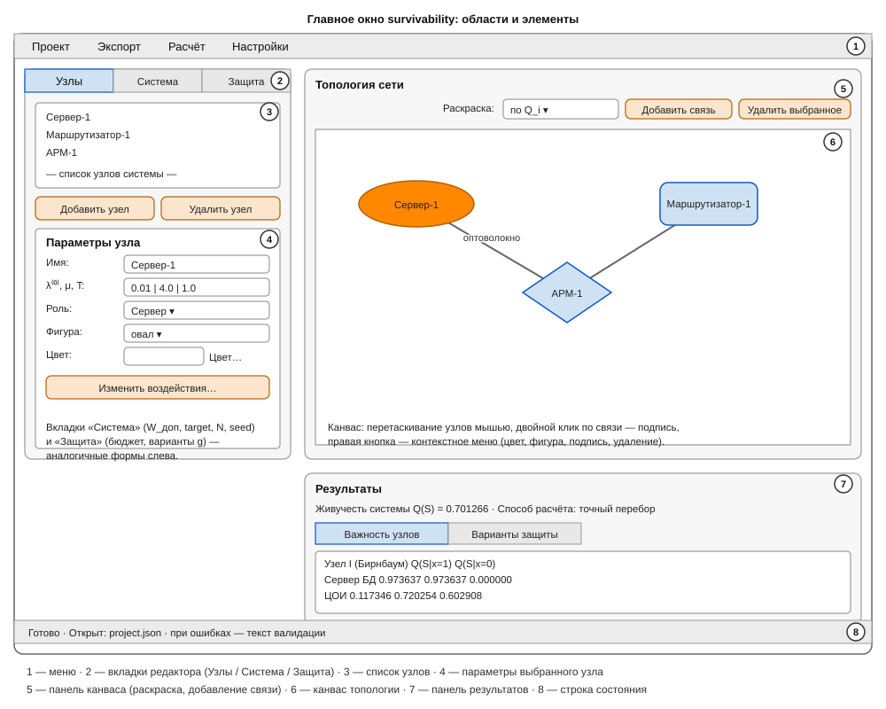

# Руководство пользователя

Подробное описание графической оболочки `survivability` — каждого элемента
окна и типовых сценариев работы. Консольные режимы и формат входных
данных — в разделе «Формат входного JSON» ниже и в
[quickstart.md](quickstart.md). Окно открывается командой
`python -m survivability.gui`.

## 1. Общая компоновка окна



Окно разделено на две части.

**Слева — панель редактирования** (шириной ~430 px) с вкладками:

- **«Узлы»** — список узлов системы и параметры выбранного узла;
- **«Система»** — параметры всей системы;
- **«Защита»** — бюджет и варианты защиты (задача 3).

**Справа — рабочая область** из двух блоков:

- **«Топология сети»** — канвас (схема сети) и панель управления им:
  переключатель раскраски, кнопки «Добавить связь» и «Удалить выбранное»;
- **«Результаты»** — сводная строка и две вкладки с таблицами (важность
  узлов, варианты защиты).

Внизу окна — строка состояния: сообщения об открытии/сохранении файлов,
подсказки режимов и ошибки. Меню: **«Проект»**, **«Экспорт»**, **«Расчёт»**,
**«Настройки»** — описаны в разделе 7.

Вся валидация выполняется автоматически через модель данных: если значение
некорректно (например, вероятность поражения больше 1), появляется диалог
с текстом ошибки и расчёт не запускается.

## 2. Вкладка «Узлы»

Содержит список узлов, кнопки добавления/удаления и форму параметров
выбранного узла.

**Список узлов.** Щелчок выбирает узел — его параметры загружаются в форму
ниже. Список синхронизирован с канвасом: клик по узлу на канвасе выделяет
его и в списке.

**«Добавить узел»** — открывает диалог создания узла (см. раздел 3).
**«Удалить узел»** — удаляет выбранный узел вместе с его связями,
метаданными оформления (координата, цвет, фигура, роль) и подписями
инцидентных каналов. Действие можно отменить только закрытием проекта без
сохранения.

**Форма параметров узла** (активна, когда выбран узел):

| Элемент | Назначение |
|---------|------------|
| **Имя** | Имя узла. Уникально в системе; при переименовании автоматически обновляются связи, переопределения вариантов защиты, координата и подписи каналов |
| **λ⁽⁰⁾ (собств. отказы)** | Интенсивность собственных (случайных) отказов $\lambda_i^{(0)} \geq 0$, 1/ед. времени |
| **μ (восстановление)** | Интенсивность восстановления $\mu \geq 0$; $0$ — восстановления нет |
| **T (период)** | Период оценивания $T > 0$, в тех же единицах времени, что и интенсивности |
| **Роль** | Применённая роль (см. раздел 3). Выбор роли из списка заново заполняет $\lambda^{(0)}$, $\mu$, $T$ и список воздействий значениями роли; «— не задана —» снимает привязку (параметры не меняются) |
| **Фигура** | Вид узла на канвасе и в SVG: прямоугольник (по умолчанию), овал, трапеция, ромб |
| **Цвет…** | Кнопка с образцом текущего цвета; открывает диалог выбора цвета. По умолчанию — светло-голубой |
| **«Изменить воздействия…»** | Диалог списка деструктивных воздействий: таблица «Воздействие | Интенсивность λ | Вероятность поражения p». «Добавить»/«Удалить» редактируют список; пустое имя строки игнорируется, некорректные числа при «ОК» отклоняются с сообщением |

Изменение любого поля сразу помечает проект как изменённый (звёздочка
в заголовке окна) и перерисовывает канвас.

## 3. Роли узлов и диалог «Добавить узел»

**Роль** — именованный шаблон параметров узла (примерные $\lambda^{(0)}$,
$\mu$, $T$ и типовые воздействия). Роль ускоряет сборку проекта: вместо
ручного ввода всего набора достаточно выбрать тип устройства.

**Диалог «Добавить узел»** (кнопка «Добавить узел»):

- **Имя** — по умолчанию «Узел-N»; при выборе роли, пока имя не меняли,
  предлагается имя от роли с уникальным номером («Сервер-2»).
- **Роль** — выпадающий список: «— вручную —» (нулевые параметры по
  умолчанию) и все доступные роли. Под списком — подсказка с параметрами
  выбранной роли. «ОК» создаёт узел с предзаполненными полями; параметры
  после создания можно менять свободно — связь с ролью не жёсткая.
- Применённая роль запоминается в свойствах узла и показывается
  в комбобоксе «Роль» формы параметров.

**Встроенная библиотека ролей** (задана в коде, не редактируется):
Сервер, Маршрутизатор, Коммутатор, Рабочая станция, Датчик/терминал —
с параметрами, типичными для класса устройств (интенсивности условные,
в 1/сутки).

**Пользовательские роли** — «Настройки → Роли узлов…»:

- слева — список ролей проекта, справа — параметры выбранной;
- «Добавить»/«Удалить» — управление списком;
- «Копировать встроенную» — берёт роль из встроенной библиотеки как основу
  для своей (копия получает имя «Копия — …»);
- кнопка «Воздействия…» открывает тот же диалог воздействий, что и для узла;
- «ОК» проверяет все роли (параметры должны быть допустимы для узла:
  интенсивности $\geq 0$, $p \in [0; 1]$, $T > 0$) и сохраняет их **в файл
  проекта** — вместе с проектом роли переносятся на другую машину.

Пользовательские и встроенные роли объединяются в списках выбора;
если имена совпадают, используется первая в списке.

## 4. Вкладка «Система»

Параметры всей системы $S = \langle E, L, F \rangle$:

| Элемент | Назначение |
|---------|------------|
| **Имя системы** | Произвольная строка; используется в заголовках отчётов и на схеме SVG |
| **W_доп (порог деградации)** | Допустимый порог $W_{\text{доп}} \in [0; 1]$: система считается работоспособной, если $W(X) \geq W_{\text{доп}}$ |
| **Целевая функция** | Вид $W(X)$: `node_fraction` — доля работоспособных узлов; `connectivity` — доля связных пар (по компонентам связности графа живых узлов) |
| **Прогоны Монте-Карло** | Число прогонов $N$ (по умолчанию $10^5$); используется только при $n > 20$, когда точный перебор невозможен |
| **Зерно ГПСЧ** | Флажок «фиксированное зерно» + целое значение. При включении расчёт Монте-Карло воспроизводим: одинаковый файл даёт побитово одинаковый результат |

## 5. Вкладка «Защита»

Редактор условий задачи 3 (выбор рационального способа защиты $g^*$).

**Флажок «Задача 3: сравнение вариантов защиты и выбор g*»** включает/выключает
секцию `protection` в файле проекта. При включении появляются:

| Элемент | Назначение |
|---------|------------|
| **Бюджет C_доп** | Максимально допустимая суммарная стоимость варианта $C_{\text{доп}} \geq 0$. Варианты дороже бюджета помечаются «НЕТ» и в выбор $g^*$ не проходят |
| **Список вариантов** + «Добавить вариант»/«Удалить вариант» | Набор альтернатив $g$; минимум один вариант должен остаться |
| **Имя / C(g)** | Имя варианта (уникальное) и его стоимость $C(g) \geq 0$ |
| **Таблица переопределений узлов** | По строке на узел системы. Пустые ячейки λ⁽⁰⁾/μ — параметр не меняется; число — новое значение. Двойной клик по ячейке «Воздействия» открывает диалог: заданный список **полностью заменяет** исходные воздействия узла в этом варианте (экранирование, фильтрация трафика) |
| **Добавляемые связи** | Структурное резервирование: два комбобокса с именами узлов + «Добавить». Резервная связь действует только внутри своего варианта. Петли, дубликаты и связи, уже имеющиеся в системе или в другом варианте, отклоняются с сообщением |

## 6. Канвас топологии

Визуальная схема сети. Узлы — фигуры с именами, связи — линии.

**Перемещение.** Зажать левую кнопку на узле и перетащить. Координаты
запоминаются и сохраняются в файле проекта (секция `gui`, см. раздел 8);
при следующем открытии расстановка восстанавливается. Узлы без координат
(например, добавленные вручную в JSON) раскладываются по окружности.

**Выбор.** Клик по узлу выбирает его (на канвасе и в списке вкладки
«Узлы»). Клик по линии выделяет связь красным. Клик по пустому месту
снимает выбор.

**Добавление связи.** Кнопка «Добавить связь» (курсор становится
перекрестием) → клик по первому узлу → клик по второму. Повторяющиеся
связи отклоняются с сообщением в строке состояния; выход из режима —
клик по пустому месту или повторное нажатие кнопки.

**Удаление.** Клавиша Delete, кнопка «Удалить выбранное» или пункт
контекстного меню. При удалении узла удаляются его связи, оформление
и подписи инцидентных каналов; при удалении связи — её подпись.

**Контекстное меню (правая кнопка):**

- по узлу: **«Цвет…»** (диалог выбора), **«Фигура»** (подменю из четырёх
  видов с отметкой текущего), **«Удалить узел»**;
- по связи: **«Подпись канала…»**, **«Удалить связь»**.

**Подписи каналов связи.** Двойной клик по линии или «Подпись канала…»
в меню — текстовое поле (например, «оптоволокно», «радиорелейный канал»,
«VPN»). Подпись рисуется посередине линии с белым фоном, сохраняется
в проекте; пустая строка — подпись удаляется.

**Оформление узлов.** Цвет и фигура из свойств узла (вкладка «Узлы»)
или контекстного меню канваса действуют одновременно на канвасе,
в экспорте SVG и (фигуры) в DOT.

**Раскраска по результатам.** Переключатель над канвасом «по Q_i» /
«по критичности I_i». После расчёта (F5/F6) узлы перекрашиваются тепловой
шкалой «зелёный → жёлтый → красный» по выбранной величине — ручные цвета
в этом режиме не используются, возвращаются при сбросе значений.

## 7. Меню

**«Проект»:**

- «Новый проект» (Ctrl+N) — пустой проект с одним узлом; несохранённые
  изменения запрашивают подтверждения;
- «Открыть…» (Ctrl+O) — файл формата CLI (см. раздел 8); файл одиночного
  узла без ключа `system` не открывается — GUI показывает подсказку;
- «Сохранить» (Ctrl+S), «Сохранить как…» — запись в формате CLI плюс
  секция `gui`; перед записью проект валидируется, при ошибке файл
  не пишется;
- «Экспорт результатов…» — JSON/CSV последнего расчёта (те же функции,
  что `--output` в CLI);
- «Выход» (Ctrl+Q).

**«Экспорт»:**

- «Экспорт схемы SVG…» — схема в компоновке канваса: фигуры и цвета узлов,
  подписи каналов, а после расчёта — подписи со значениями $Q_i$/$I_i$,
  тепловая шкала и легенда. Файл — валидный SVG, открывается в браузере;
- «Экспорт схемы DOT…» — текстовый формат Graphviz (фигуры переносятся
  в атрибуты `shape`) для внешней отрисовки.

**«Расчёт»:**

- «Рассчитать Q(S)» (F5) — живучесть системы и важность узлов;
- «Сравнить варианты защиты» (F6) — задача 3 (требуется включённая
  вкладка «Защита»).

Расчёт выполняется в фоновом потоке — интерфейс не блокируется; при ошибке
показывается диалог с текстом.

**«Настройки»:**

- «Роли узлов…» — редактор пользовательских ролей (см. раздел 3).

## 8. Файлы проекта и обмен с CLI

Файл проекта — JSON в кодировке UTF-8. Структура совпадает с форматом
входного файла CLI: ключи `system` (обязательный) и `protection`
(опциональный), описанные в разделе 10. **Плюс** опциональная служебная
секция верхнего уровня `gui` с метаданными оболочки:

```json
"gui": {
  "roles": [{"name": "Шлюз", "own_failure_rate": 0.01, "recovery_rate": 4.0,
             "period": 1.0, "impacts": []}],
  "positions": {"Узел-1": [320.0, 180.0]},
  "nodes": {"Узел-1": {"color": "#cfe2f3", "shape": "oval",
                       "role": "Сервер"}},
  "link_labels": [{"a": "Узел-1", "b": "Узел-2", "label": "оптоволокно"}]
}
```

- `roles` — пользовательские роли (раздел 3);
- `positions` — координаты центров узлов на канвасе;
- `nodes` — оформление узлов: цвет `#rrggbb`, фигура (`rectangle`,
  `oval`, `trapezoid`, `diamond`), применённая роль;
- `link_labels` — подписи каналов связи.

Консольная утилита секцию `gui` **игнорирует**, поэтому:

- файл, сохранённый в GUI, открывается в CLI без правок:
  `python -m survivability --file project.json` — и даёт те же числа;
- файл примера `examples/example*.json` (без секции `gui`) открывается
  в GUI — узлы раскладываются по окружности, цвета и фигуры стандартные.

При переименовании узла его координата, оформление и подписи связей
переносятся на новое имя автоматически; при удалении — удаляются.
Повреждённые записи секции отбрасываются при открытии файла без
прерывания загрузки.

## 9. Панель результатов

Под канвасом. Сводная строка + вкладки таблиц (появляются после расчёта).

**После F5 («Рассчитать Q(S)»):**

- сводка: $Q(S)$ с шестью знаками, способ расчёта («точный перебор» или
  «Монте-Карло, N=…»), для Монте-Карло — доверительный интервал Уилсона 95 %;
- вкладка «Важность узлов»: по строке на узел — критичность Бирнбаума $I_i$,
  $Q(S \mid x_i = 1)$, $Q(S \mid x_i = 0)$. Большое $I_i$ — узел, отказ
  которого сильнее всего снижает живучесть; именно его резервирование
  даёт максимальный прирост;
- канвас перекрашивается по выбранной величине (см. раздел 6).

**После F6 («Сравнить варианты защиты»):**

- сводка: $Q_{\text{base}}(S)$ (без защиты), бюджет, выбранный $g^*$,
  $Q_{g^*}(S)$, прирост $\Delta Q$ (абсолютный и относительный в процентах),
  эффективность затрат $\Delta Q / C(g^*)$;
- вкладка «Варианты защиты»: по строке на вариант — $C(g)$, допустимость
  по бюджету («да»/«НЕТ»), $Q_g(S)$ (с ДИ для Монте-Карло), $\Delta Q$ к базе;
  у рационального варианта — пометка «★ g*».

## 10. Формат входного JSON

Описывает **тот же файл**, который читает CLI и сохраняет GUI. Три режима
распознаются по ключам верхнего уровня.

### 10.1. Одиночный узел (задача 1)

Без ключей `system`/`protection` — параметры узла напрямую:

```json
{
  "name": "Сервер маршрутизации",
  "own_failure_rate": 0.02,
  "recovery_rate": 2.0,
  "period": 24.0,
  "impacts": [
    {"name": "DDoS-атака", "intensity": 1.5, "defeat_probability": 0.4}
  ]
}
```

| Поле | Тип | Обязательность | Единица | Ограничение |
|------|-----|----------------|---------|-------------|
| `name` | строка | нет (по умолчанию `"узел"`) | — | — |
| `own_failure_rate` | число | **да** | 1/ед. времени | $\geq 0$ |
| `recovery_rate` | число | нет (по умолчанию $0$ — без восстановления) | 1/ед. времени | $\geq 0$ |
| `period` | число | **да** | ед. времени | $> 0$ |
| `impacts` | массив | **да** (может быть `[]`) | — | — |
| `impacts[].name` | строка | **да** | — | непустое |
| `impacts[].intensity` | число | **да** | 1/ед. времени | $\geq 0$ |
| `impacts[].defeat_probability` | число | **да** | — | $[0; 1]$ |

**Важно:** все интенсивности и период — в одних и тех же единицах времени.
Готовые образцы: `examples/example1_basic.json` … `example5_minimal.json`.

### 10.2. Система (задача 2, ключ `system`)

```json
{
  "system": {
    "name": "ЦОИ — линейная цепочка",
    "nodes": [
      {"name": "ЦОИ", "own_failure_rate": 0.01, "recovery_rate": 4.0, "period": 1.0,
       "impacts": [
         {"name": "Массовая DDoS-атака (Н1–Н2)", "intensity": 2.0, "defeat_probability": 0.30},
         {"name": "Целевая кибератака (Н3)", "intensity": 0.1, "defeat_probability": 0.70},
         {"name": "РЭП / разрыв канала (Н4)", "intensity": 0.2, "defeat_probability": 0.50}]}
    ],
    "links": [["ЦОИ", "Сервер БД"]],
    "w_def": 0.3333333333333333,
    "target": "connectivity",
    "seed": 42
  }
}
```

| Поле | Тип | Обязательность | Ограничение |
|------|-----|----------------|-------------|
| `name` | строка | нет (по умолчанию `"система"`) | — |
| `nodes` | массив | **да**, ≥ 1 | формат узла — как в 10.1; **имя каждого узла обязательно** и уникально |
| `links` | массив пар имён | нет (по умолчанию `[]`) | оба конца — существующие узлы; без петель и дубликатов (неориентированный граф) |
| `w_def` | число | **да** | $W_{\text{доп}} \in [0; 1]$ |
| `target` | строка | нет (по умолчанию `node_fraction`) | `node_fraction` — доля работоспособных узлов; `connectivity` — доля связных пар по компонентам связности |
| `monte_carlo_runs` | целое | нет (по умолчанию $10^5$) | > 0; используется при $n > 20$ |
| `seed` | целое | нет | зерно ГПСЧ Монте-Карло |

Способ расчёта выбирается автоматически: $n \leq 20$ — точный перебор всех
$2^n$ векторов состояний, $n > 20$ — Монте-Карло с доверительным интервалом
Уилсона 95 %. Связи считаются надёжными: отказывают только узлы.

Примеры: `examples/example6_system_line.json` (цепочка ЦОИ–сервер–АРМ,
$Q(S) = 0.701266$), `example7_system_parallel.json` (два резервных сервера).

### 10.3. Защита (задача 3, ключ `protection`)

Рядом с `system`:

| Поле | Тип | Обязательность | Ограничение |
|------|-----|----------------|-------------|
| `budget` | число | **да** | $C_{\text{доп}} \geq 0$ |
| `variants` | массив | **да**, ≥ 1 | имена уникальны |
| `variants[].name` | строка | **да** | уникально |
| `variants[].cost` | число | **да** | $C(g) \geq 0$ |
| `variants[].nodes` | объект | нет | переопределения по именам существующих узлов: `own_failure_rate`, `recovery_rate`, `impacts` (список полностью заменяет исходный) |
| `variants[].links_added` | массив пар имён | нет | резервные связи: существующие узлы, без петель, дубликатов и дублирования имеющихся связей |

Выбор: допустимое множество $\{g : C(g) \leq C_{\text{доп}}\}$ (пустое —
ошибка с перечнем стоимостей, код возврата 2); $g^* = \arg\max Q_g(S)$
(при равенстве — меньшая стоимость, затем имя). Все оценки Монте-Карло —
на общем потоке случайных чисел с зерном `seed` (перекрывается `--seed`),
поэтому результат воспроизводим. Примеры: `example8_variants_chain.json`
(цепочка, три варианта), `example9_variants_filter.json` (кольцо из 22
сегментов, Монте-Карло, $N = 50\,000$).

### 10.4. Запуск из консоли

```bash
python -m survivability --file examples/example8_variants_chain.json
python -m survivability --file examples/example9_variants_filter.json --output results.json
python -m survivability --file examples/example9_variants_filter.json --seed 7   # иное зерно
```

Коды возврата: `0` — расчёт выполнен; `2` — ошибка входных данных
(невалидный JSON, значение вне диапазона, файл не найден, пустое
допустимое множество вариантов); `1` — ошибка записи файла результатов.
Ошибка ввода выглядит так (`examples/error_invalid.json`):

```
Ошибка ввода: Некорректный формат входных данных: Вероятность поражения должна лежать в диапазоне [0; 1]: 1.5
```

## 11. Типовые сценарии

**Создать проект с нуля.** «Проект → Новый проект» → «Узлы → Добавить
узел» (выбрать роль «Сервер», имя оставить предложенное) → добавить ещё
два-три узла других ролей → на канвасе расставить узлы мышью → «Добавить
связь» и соединить пары → задать W_доп на вкладке «Система» → F5 →
смотреть $Q(S)$ и таблицу важности → «Проект → Сохранить как…».

**Открыть пример и посчитать.** «Проект → Открыть…» → выбрать
`examples/example6_system_line.json` → F5. Узлы появятся по окружности;
перетащите их удобнее, переключите раскраску на «по критичности I_i» —
видно, что Сервер БД (средний) критичнее крайних.

**Сравнить варианты защиты.** Открыть `examples/example8_variants_chain.json`
→ F6. В таблице вариантов «Комплексная защита» отмечена «НЕТ» (вне бюджета),
у «Резервный канал ЦОИ–АРМ» — «★ g*»: структурное резервирование сняло
единственную точку отказа, $\Delta Q \approx +0{,}20$ (+28 %).

**Оформить и экспортировать схему.** Выделить узел → в свойствах задать
фигуру «ромб» и цвет → двойной клик по связи → ввести «оптоволокно» →
F5 (появятся значения на узлах) → «Экспорт → Экспорт схемы SVG…» →
открыть файл в браузере.

**Перенести проект на другую машину.** «Проект → Сохранить», передать
JSON. Получатель откроет его в GUI (с координатами, оформлением и ролями)
или посчитает в консоли — числа совпадут.

## 12. См. также

- [quickstart.md](quickstart.md) — установка и первый запуск;
- [formulas.pdf](formulas.pdf) — вывод формул $Q_i$, $Q(S)$, выбора $g^*$;
- [system_topology.md](system_topology.md) — как считается $Q(S)$ с учётом
  топологии: формулы, алгоритм, пример с ручной сверкой (инфографика —
  [qs_topology.svg](qs_topology.svg));
- [node_types.md](node_types.md) — условия применимости методики, сведение
  сложных элементов к модели узла;
- [answ0001.md](answ0001.md) — практическое применение и эффект внедрения;
- `examples/` — девять проверенных примеров входных файлов.
